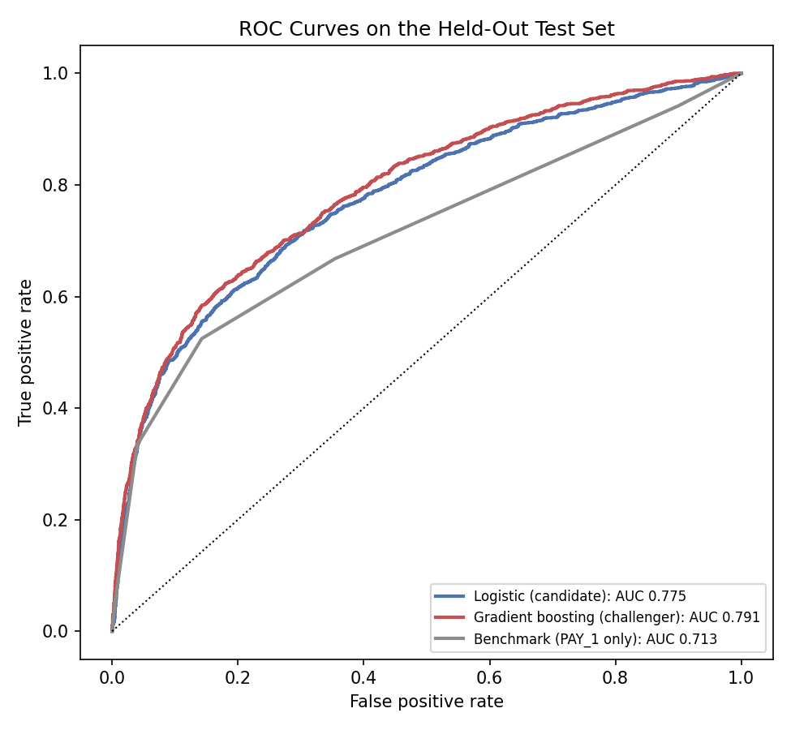
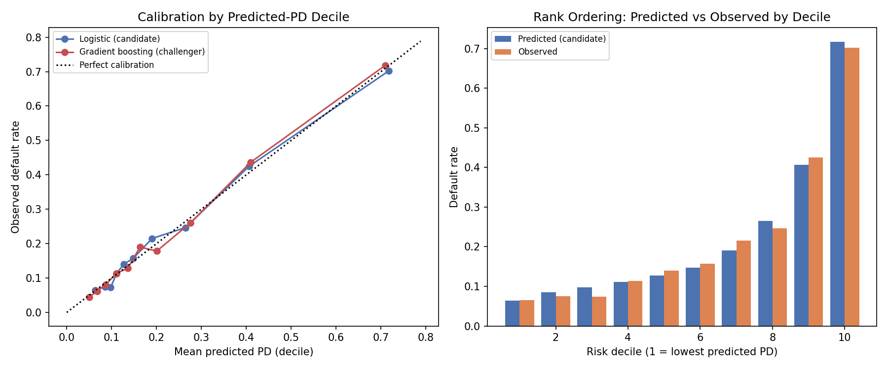
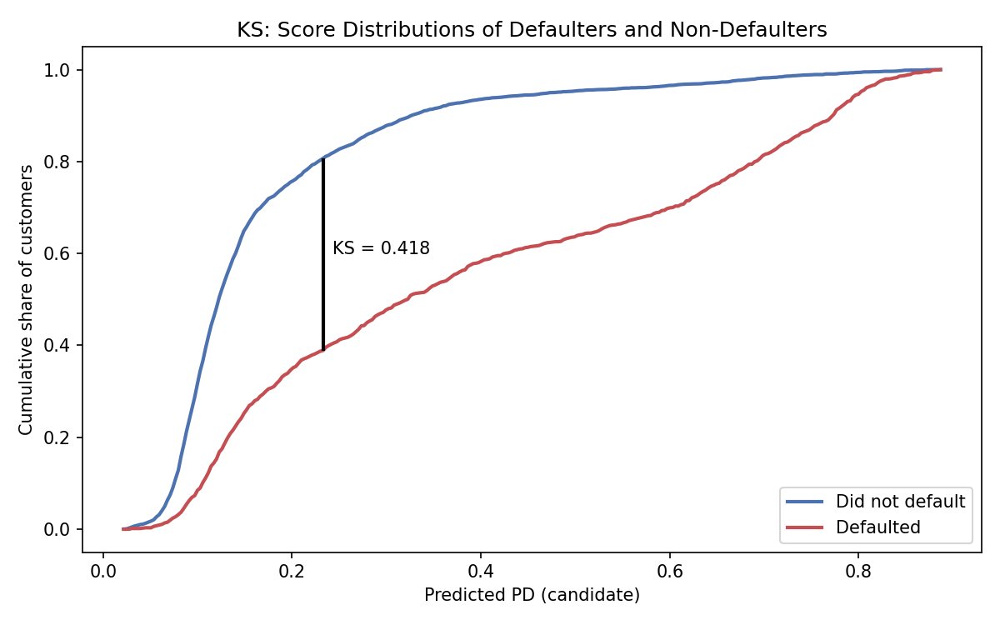
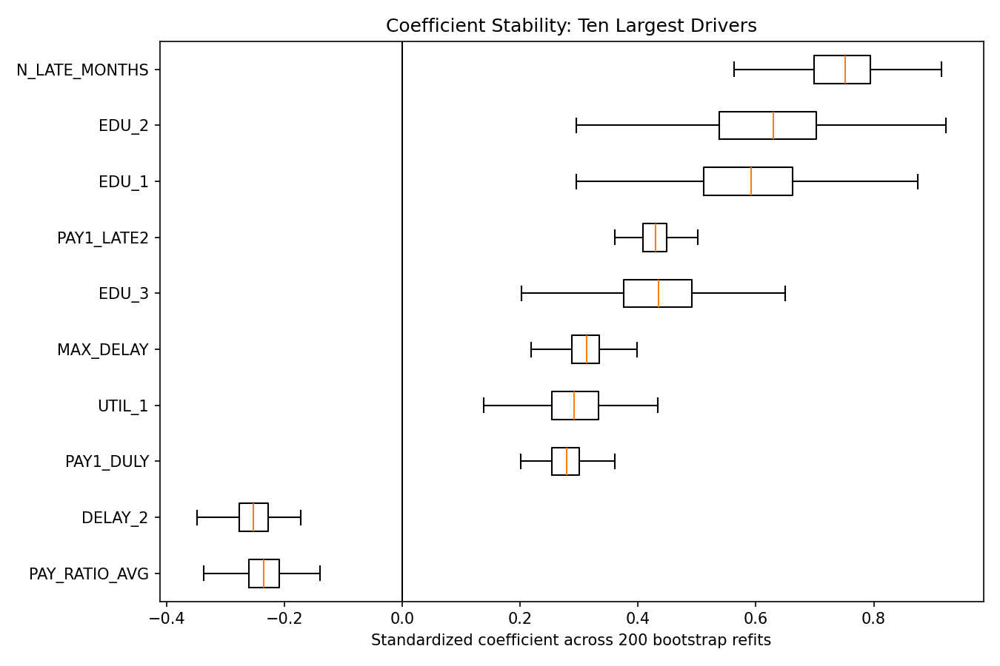
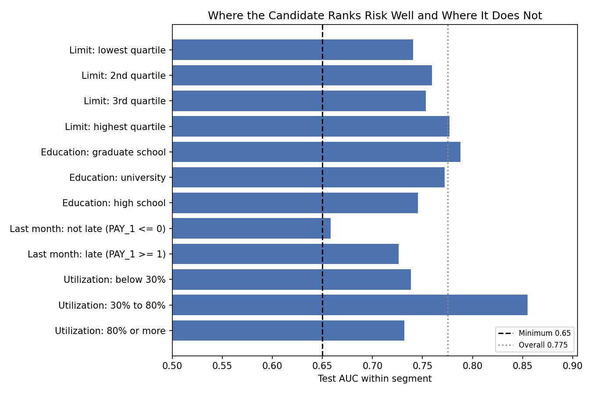
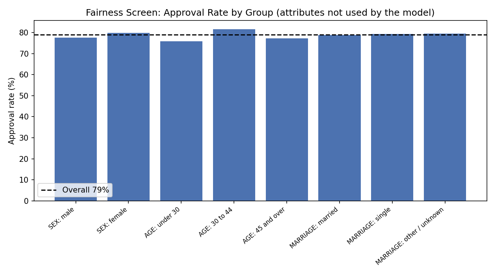

# Credit Default Model and Independent Validation

A probability-of-default (PD) model for consumer credit, built in Python, followed by a validation
written the way a model risk team would: pre-set acceptance criteria, a challenger and a benchmark,
calibration, stability, segment and fairness checks, and findings with severity ratings. Two of the
twelve criteria failed, and the report says so.

Part of a risk series:
[var-calculator](https://github.com/ducksmell-sys/var-calculator) ·
[garch-calculator](https://github.com/ducksmell-sys/garch-calculator) ·
[var-backtester](https://github.com/ducksmell-sys/var-backtester) ·
[dcc-garch-calculator](https://github.com/ducksmell-sys/dcc-garch-calculator) ·
[stress-test-calculator](https://github.com/ducksmell-sys/stress-test-calculator)

## Data

UCI "Default of credit card clients" (Taiwan, 2005): 30,000 credit card customers, six months of
repayment status, bill and payment history, and whether the customer defaulted the next month (22.1%
did). It is consumer credit rather than loan-level data, so treat it as a stand-in: the modeling and
validation steps are the same for a loan PD model. Public loan-level datasets such as Lending Club need
an account to download and were not used.

## Model

| Item | Choice |
|---|---|
| Candidate | Logistic regression on 22 engineered features (interpretable) |
| Challenger | Gradient boosting (same features) |
| Benchmark | Logistic regression on last month's repayment status only |
| Split | Stratified 60 / 20 / 20 train / validation / test (the data has no time dimension) |
| Protected attributes | `SEX`, `MARRIAGE`, `AGE` are **not** model inputs; they are used only for a fairness screen afterwards |

Features describe repayment history (recent status, number of late months, maximum delay), utilization,
payment behaviour and limit size. The most recent repayment status is one-hot coded because its
relationship to default is not monotone: customers who "paid duly" default more than those with
revolving credit.

## Files

| File | Description |
|---|---|
| `credit_data.py` | Loading, column naming, data-quality checks, feature engineering, split |
| `credit_models.py` | Candidate, challenger and benchmark |
| `credit_metrics.py` | AUC, KS, Gini, calibration slope, Hosmer-Lemeshow, PSI, bootstrap intervals |
| `validate_credit_model.py` | The full validation: twelve sections (including a follow-up check), a summary against the criteria, and six charts |
| `VALIDATION_credit_model.md` | The validation report: findings, severity ratings, conditions of use |

## Usage

```bash
pip install numpy pandas scikit-learn scipy matplotlib
python validate_credit_model.py
```
The run takes about 25 seconds and is deterministic (fixed seeds, data cached by scikit-learn).

## Results against the pre-set criteria

The thresholds are rules of thumb. They were chosen before the full validation script was written, but
after a smoke run had shown the headline test AUCs; they were not adjusted to those numbers.

| Result | Criterion | Value |
|---|---|---|
| PASS | Test AUC at least 0.72 | 0.775 (95% interval 0.761 to 0.790) |
| PASS | Test KS at least 0.35 | 0.418 |
| PASS | Train-test AUC gap at most 0.03 | 0.004 |
| **FAIL** | All coefficient signs match credit logic | 7 of 16 checked signs do not |
| PASS | Mean predicted PD within 0.01 of observed | 0.2210 against 0.2212 |
| PASS | Calibration slope between 0.90 and 1.10 | 0.987 |
| PASS | PSI (train vs test) below 0.10 | largest 0.0025 |
| PASS | Segment AUC at least 0.65 (n at least 500) | lowest 0.658 |
| PASS | Top-5 coefficient signs stable in 95% of bootstrap refits | 100% |
| PASS | AUC loss under 10% input noise at most 0.01 | 0.0002 |
| PASS | Adverse impact ratio at least 0.80 for every group | lowest 0.93 |
| **FAIL** | Challenger does not beat candidate by 0.01 AUC | +0.0154 (interval +0.0098 to +0.0218) |







## What the validation found

**1. The candidate ranks and calibrates well, but some coefficients have the wrong sign.** The delay
coefficients for months 2 to 6 are negative and `UTIL_AVG` is negative, which contradicts credit logic.
The cause is collinearity: the late-month count has a variance inflation factor of 18.2, and the
individual delay months overlap with it. A simpler 12-feature specification removes the problem (zero
sign mismatches, no VIF above 10) with no loss of accuracy: validation AUC 0.7627 against 0.7625.



**2. The gradient boosting challenger is materially better.** It beats the logistic candidate by 0.015
AUC with an interval clearly above zero, and it is also calibrated (slope 1.04). The decision to keep
the logistic model has to be justified on interpretability and adverse-action explanations, not on
accuracy.

**3. The education variable is not worth keeping.** Its coefficients are measured against a reference
group of only 345 records and are the least stable of the ten largest drivers, and removing education
changes test AUC by 0.0008. It is also a possible proxy for protected characteristics.

**4. Ranking is weakest where most customers are.** Among customers who were not late last month (77% of
the test set) AUC is 0.658, just above the 0.65 threshold, against 0.726 for customers who were late.



**5. Calibration gaps by group.** The model does not use sex, marital status or age, and approval rates
are close across groups (adverse impact ratios 0.93 to 1.00). But three of eight group results show a
calibration gap of two or more standard errors: customers under 30 are over-predicted, customers 45 and
over and married customers are under-predicted. If the eight results were independent, about 0.4 such
flags would be expected by chance, so this is a monitoring item and not evidence of bias.



**6. Data documentation gaps.** 17,496 of the 30,000 customers have a last-month repayment code (-2 or
0) that the dataset's documentation does not define, plus undocumented education and marriage codes,
56 duplicate rows and 590 negative bill amounts.

## Business view

Rejecting the highest-risk customers separates good and bad outcomes sharply:

| Approve the lowest-risk | Default rate among approved | Default rate among rejected |
|---|---|---|
| 50% | 9.33% | 34.90% |
| 70% | 11.98% | 45.78% |
| 80% | 13.56% | 56.33% |
| 90% | 16.78% | 70.17% |

The overall default rate is 22.12%.

## Limitations

- The data has no dates, so there is no out-of-time test and PSI between a random train and test split
  is trivially small. A real validation needs a later period to test drift.
- One dataset from one country and year; the model is not a production credit model.
- The same person built and validated the model, so the validation is not independent in the sense a
  bank requires. The pre-set criteria and the reporting of failures are the mitigation.
- No reject inference: only customers who held a card are observed.
- Fairness is screened with a common heuristic (adverse impact ratio) and calibration by group. This is
  not a legal compliance assessment.
- The test set was used for the final comparisons, including the challenger and the simpler
  specification (which was chosen on validation AUC and sign logic and confirmed on test).

See [VALIDATION_credit_model.md](VALIDATION_credit_model.md) for the full report with severity ratings
and conditions of use.
